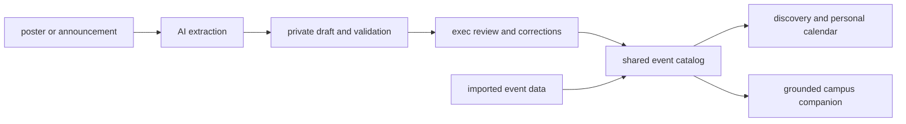

# func.on

**less searching. more showing up.**

An AI-assisted campus events platform built for Warwick University at **GreatUniHack 2026**. Discover society events, find your people, and make plans that fit your day.

## The problem

Campus life offers plenty to do, but finding it often means checking separate society pages, social feeds and group chats. Announcements arrive as posters or informal captions, and it is easy to miss something or discover a clash too late.

func.on brings those events together, with tools for students to discover them and society execs to publish them.

## Features

- **Discover:** scroll through an image-led event feed, with filters for category, date, saved events and clashes.
- **Relevant search:** find related activities, such as bus trips and away days when searching for travel.
- **Personal calendar:** save favourites, reserve places in the demo, and view daily plans.
- **Clash detection:** compare event times against saved plans, with animated visual warnings.
- **Student onboarding:** select your course, interests and society preferences.
- **Campus companion:** ask for events in natural language, such as “free food tomorrow without clashes”.
- **AI-assisted publishing:** extract event details from an announcement or poster, correct the draft, and approve publication.
- **Useful badges:** orange for free food and blue for free entry, with uncertain inferences labelled.
- **Vendor promotions:** external accounts can build a promotion and preview simulated payment.

## Where AI fits

Claude extracts announcements and posters into structured event drafts. Missing or uncertain details are flagged for human review. Server-side checks validate details and block duplicate publication through the reviewed workflow.

For companion search, Claude translates the current request into filters and related keywords. Code selects and ranks actual database events and checks clashes. The model cannot invent a result or publish an event.

Discover search uses deterministic keyword matching and concept expansion rather than making an AI call. If Claude is unavailable, the companion falls back to labelled basic search. Companion conversation history is not stored in the application database.



## Built with

| Layer | Technology |
| --- | --- |
| Frontend | HTML, CSS, vanilla JavaScript, Afacad typography |
| Local web server | Node.js with an API proxy |
| Backend | Python, FastAPI, Uvicorn |
| Storage | SQLite |
| AI | Anthropic Claude API and structured tool calls |
| Live updates | Server-sent events with polling fallback |
| Collaboration | Git and GitHub |

## Run locally

You need **Python 3.12+** and a recent **Node.js** release. These commands use Windows PowerShell and start from the repository root.

### 1. Install dependencies

```powershell
python -m venv .venv
.\.venv\Scripts\python.exe -m pip install -r warwick-events/BACKEND/requirements.txt
```

Reuse an existing `.venv` if you already have one. Activation is optional. No Node dependency installation is required.

### 2. Configure AI

Copy the root `.env.example` to `.env` in the repository root, **only if you do not already have a configured `.env`**:

```powershell
Copy-Item .env.example .env
```

Fill in your server-side settings:

```dotenv
ANTHROPIC_API_KEY=your_api_key
ANTHROPIC_MODEL=your_available_model_id
```

Keep credentials private. `.env` and local databases are excluded from Git. AI requests may incur provider charges. Without credentials, manual event creation and basic search remain available.

### 3. Start the app

```powershell
cd warwick-events/FRONTEND
npm.cmd start
```

Open **http://localhost:3000**. The launcher also starts the Python API on port **8000**. Interactive API documentation is at **http://127.0.0.1:8000/docs**.

Stop older server instances before starting a new one. `npm.cmd` avoids PowerShell script-policy issues. On macOS/Linux, use `.venv/bin/python` for setup and `npm start` to launch.

### 4. Load sample events (optional)

In another terminal, from the repository root:

```powershell
cd warwick-events
..\.venv\Scripts\python.exe -m BACKEND.ingest BACKEND/examples/seed_events.json
```

Identical records are skipped on reimport. Imported events with a start time appear in the shared catalog; review flags remain visible. Sample data has fixed dates, so some events may already be in the past.

## Try the demo

1. Choose **exec** at login and enter a demo email.
2. Open **make an event**, paste an announcement or upload a supported poster, and extract its details.
3. Select the private draft, correct missing information, confirm your review, and publish.
4. In another browser tab, choose **student** and complete onboarding.
5. Find the event in Discover, save or reserve it, then inspect your calendar.
6. Ask the companion for a relevant event without clashes. Published events arrive through live updates.

## Checks

From the repository root:

```powershell
npm.cmd --prefix warwick-events/FRONTEND run check
```

From `warwick-events`:

```powershell
..\.venv\Scripts\python.exe -m unittest discover -s BACKEND/tests -v
```

Backend tests use temporary databases and mocked AI responses rather than paid model calls. They cover extraction, validation, persistence, imported events, search ranking, event benefits, onboarding and workflow permissions.

## Prototype boundaries

- Email and role selection are demo identity, not verified Warwick sign-in.
- Reservations record intent; they do not issue real society tickets or guarantee admission.
- Official-status requests stay pending rather than granting university verification.
- Missing prices are not treated as free admission. Likely free-food inferences are labelled for confirmation.
- Vendor payments are simulated; no money is charged or advertisement delivered.
- Announcements and posters are sent to the configured AI provider when extraction is requested.
- The legacy `/submit` endpoint stores extracted records immediately, including review flags. The frontend's `/api` flow uses private drafts and explicit approval.

## Challenges and lessons

Our biggest challenges were turning inconsistent announcements into usable data, combining event formats, and integrating parallel frontend and backend work. We learned that AI is most useful when paired with deterministic validation, clear data contracts and human review.

We are proud of connecting discovery, extraction, live updates and personal planning into one functional prototype.

## What's next

- Verified university sign-in and society permissions.
- Stronger event and official-status verification.
- Calendar export and reminders.
- Recommendations improved through student feedback.
- Permission-based integrations with society event sources.
- Real vendor checkout and clearly labelled sponsored placements.

## Project structure

```text
agent/                       Claude event extractor and schema
warwick-events/
  BACKEND/                   API, storage, search, onboarding and tests
    catalogs/                Course, society and interest catalogs
    examples/                Importable example events
  FRONTEND/                  Browser interface and local launcher
  shared/                    Shared event schema
```

See the [frontend guide](warwick-events/FRONTEND/README.md), [backend guide](warwick-events/BACKEND/README.md), and [contribution guide](CONTRIBUTING.md) for more detail.
